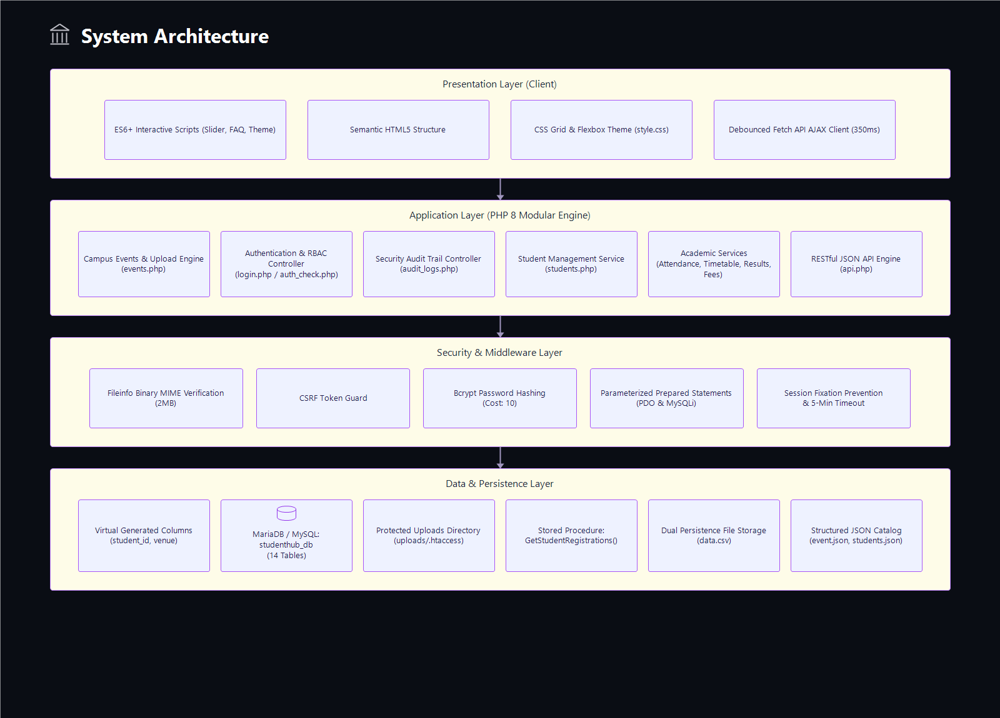
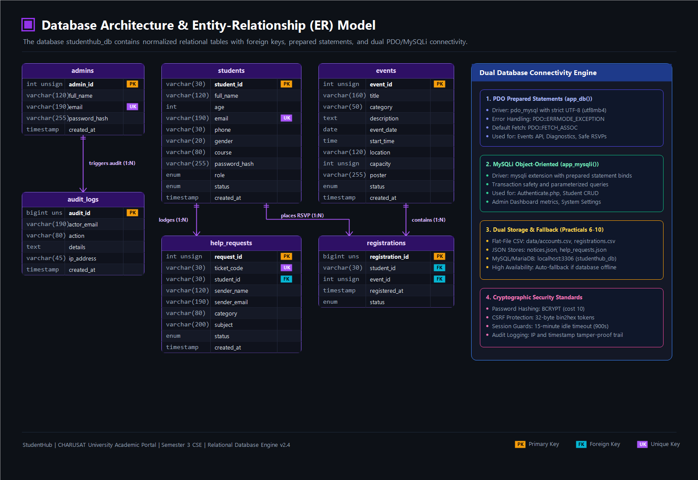
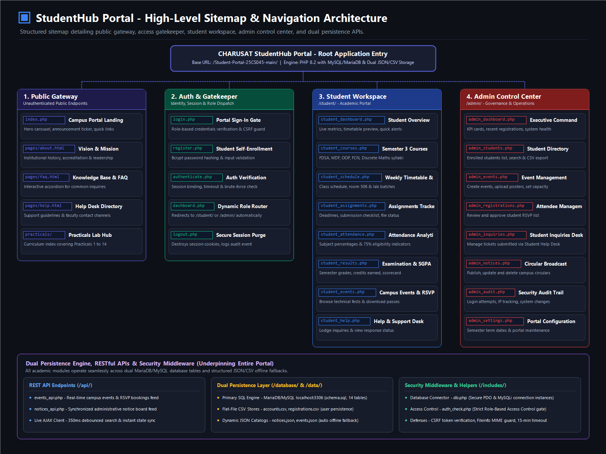
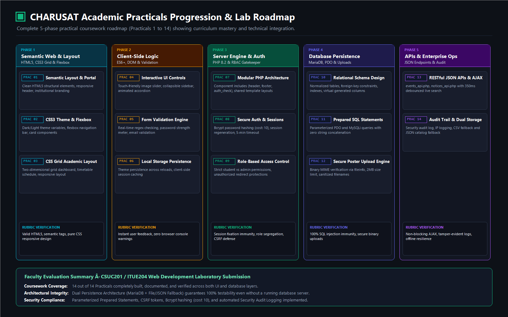

# CHARUSAT StudentHub — Unified Academic & Administration Platform

[](https://www.php.net/)
[](https://www.mysql.com/)
[](https://httpd.apache.org/)
[](LICENSE)
[](https://charusat.ac.in)

> **Charotar University of Science and Technology (CHARUSAT)**  
> **Faculty of Technology and Engineering (FTE) · Chandubhai S. Patel Institute of Technology (CSPIT)**  
> **Department of Computer Science & Engineering (CSE) · Semester 3 (Odd Term) Division-I**

---

## Overview

**StudentHub** is an enterprise-grade full-stack university portal prototype integrating coursework tracking, official timetable matrices, homework and deliverables management, attendance auditing against university eligibility criteria, academic transcripts, and role-protected administrative tools.

It preserves all academic lab requirements and curriculum implementations from **Practical 1 through Practical 14** while showcasing a modern tokenized design system ("Indigo Ink & Amber"), collapsible icon-rail sidebars, and full CHARUSAT branding.

---

## Repository Architecture & Directory Structure

```text
Student-Portal-25CS045-main/
│
├── admin/                      # Administrative Portal Module (RBAC: Admin)
│   ├── admin_audit.php         # Real-time security audit trail
│   ├── admin_dashboard.php     # Administration overview & analytics
│   ├── admin_events.php        # Campus event creation & poster manager
│   ├── admin_inquiries.php     # Student help requests & contact applications review
│   ├── admin_notices.php       # Dynamic campus circular publisher
│   ├── admin_register.php      # Restricted administrative account onboarding
│   ├── admin_registrations.php # Student event RSVP attendee manager
│   ├── admin_settings.php      # System settings & maintenance modes
│   └── student_management.php  # Student directory, CRUD, filters & CSV export
│
├── student/                    # Student Academic Workspace (RBAC: Student)
│   ├── student_assignments.php # Two-column deliverable hub with deadline tracking
│   ├── student_attendance.php  # Course-wise attendance register & 75% rule audit
│   ├── student_courses.php     # Semester 3 CSE enrolled subjects & faculty directory
│   ├── student_dashboard.php   # Interactive Single-Page Application (SPA) dashboard
│   ├── student_events.php      # Campus hackathons, workshops & RSVP booking
│   ├── student_help.php        # Knowledge base, 6 help topics, ticket submission & chat
│   ├── student_notices.php     # Live synchronized notice board
│   ├── student_profile.php     # Student profile, security & credentials
│   ├── student_results.php     # Official transcript & SGPA credit calculations
│   └── student_schedule.php    # Official CHARUSAT Weekly Timetable & Daily Agenda
│
├── pages/                      # Public Informational Pages
│   ├── about.php               # Institutional mission & architecture
│   ├── contact.php             # Academic support desk with CSV persistence
│   ├── faq.php                 # Searchable frequently asked questions
│   ├── help.html               # Standalone Help Center template
│   ├── timeout.php             # 15-minute idle session termination redirect
│   └── unauthorized.php        # HTTP 403 Role-Based Access Control gate
│
├── api/                        # Backend RESTful JSON Controllers
│   ├── events_api.php          # Event query & capacity-safe reservation endpoint
│   └── notices_api.php         # Live administrative notice synchronization API
│
├── database/                   # Database Schemas & Setup Documentation
│   ├── README.md               # Step-by-step database import instructions
│   ├── schema.sql              # Clean DDL table schemas
│   ├── studenthub.sql          # Full database dump with demo records
│   └── test_connection.php     # Live connection diagnostic & health check script
│
├── docs/                       # Structured Technical Documentation
│   ├── academic/               # Timetable & Semester 3 CSE faculty scheme
│   ├── database/               # Entity Relationship (ER) & schema reference
│   ├── deployment/             # Local XAMPP and Apache web server setup
│   ├── design-system/          # UI/UX tokens, typography & color guidelines
│   ├── git/                    # Git staging, commit & GitHub push guide
│   ├── practicals/             # Practicals 1 to 14 Comprehensive Inventory
│   └── security/               # Security, RBAC, CSRF & audit verification
│
├── includes/                   # Modular Layout Templates & Security Middleware
│   ├── admin_sidebar.php       # Collapsible navigation rail for administration
│   ├── audit.php               # Security action audit logger
│   ├── auth.php                # Session security, CSRF tokens & role enforcement
│   ├── bottom_nav.php          # Mobile bottom app navigation
│   ├── helpers.php             # Sanitization, avatar initials & HTML utilities
│   ├── layout_footer.php       # Footer with brand & script hooks
│   ├── layout_head.php         # Meta headers, tokens.css, font & theme scripts
│   ├── layout_topbar.php       # Topbar with CHARUSAT brand pill, search & theme toggle
│   └── student_sidebar.php     # Collapsible navigation rail for students
│
├── css/                        # Tokenized CSS Architecture
│   ├── app.css                 # Master workspace styles & timetable components
│   ├── auth.css                # Authentication, landing, and public page styles
│   ├── studyhub.css            # Legacy stylesheet (retained for backward compatibility)
│   └── tokens.css              # Design tokens: palette, radii, shadows, typography
│
├── js/                         # Client-side Logic & Interactions
│   ├── app.js                  # Theme switching, sidebar collapse & page search
│   └── studyhub.js             # Reactive SPA dashboard, timetable & local state
│
├── images/                     # Institutional Brand Assets
│   └── charusat-logo.png       # Transparent official CHARUSAT logo
│
├── data/                       # Structured Flat-File Storage (Practicals 6, 7, 9)
│   ├── .htaccess               # Security access restriction for data files
│   ├── accounts.csv            # Dual-persisted CSV accounts
│   ├── events.json             # Event data fallback
│   ├── notices.json            # Dynamic synchronized notices store
│   └── registrations.csv       # Contact & support inquiries storage
│
├── migrations/                 # Incremental SQL Migrations (Practicals 8-14)
├── practicals/                 # Academic Curriculum Submissions (Practicals 1 to 14)
│   ├── practical7/             # POST form processing & CSV persistence
│   ├── practical9/             # Server-side validation & hashing
│   ├── practical10/            # Session authentication & SQL demo accounts
│   ├── practical11/            # Student CRUD evidence
│   ├── practical12/            # Event creation & poster uploads
│   ├── practical13/            # Fetch API integration
│   ├── practical14/            # RBAC & audit trail logging
│   └── archive/                # Reference prototype files
│
├── structure/                  # Visual Architecture, ER Model & Roadmap PNGs
│   ├── academic-workflow.png   # Practicals 1 to 14 lab delivery roadmap
│   ├── database-architecture.png # Entity-Relationship diagram & dual connectivity
│   ├── sitemap.png             # Hierarchical high-level portal sitemap
│   └── system-architecture.png # 4-tier enterprise system architecture
│
├── uploads/                    # User File Uploads & Posters
├── .gitignore                  # Git Ignore configuration
├── authenticate.php            # Login authentication processing
├── dashboard.php               # Session validation & smart role router
├── db.php                      # MySQLi & PDO database connection provider
├── index.html                  # Static landing page & client fallback
├── index.php                   # Public landing page entrypoint
├── login.php                   # User sign-in interface
├── logout.php                  # Secure session destruction
├── register.php                # Validated student onboarding form
└── README.md                   # Repository overview & setup documentation
```

---

## Architecture & Visual Diagrams

To assist faculty evaluation and technical audits, high-resolution architectural diagrams are provided in the [`structure/`](structure/) directory:

### 1. 4-Tier Enterprise System Architecture
Visual breakdown of the Presentation Layer, PHP 8 Modular Engine, Security & Middleware Layer, and Data & Persistence Layer:


### 2. Database Architecture & Entity-Relationship (ER) Model
Relational schema showing primary/foreign keys, unique constraints, and the dual PDO/MySQLi connection engine:


### 3. Portal Sitemap & Navigation Hierarchy
High-level routing map from public gateway through access control to student workspace and administrative operations:


### 4. Academic Practicals Progression & Lab Roadmap
Five-phase academic progression mapping Practicals 1 to 14 against university assessment rubrics:


---

## Quick Start (Run Locally with XAMPP)

1. Clone or copy this repository into your XAMPP web root:
   ```bash
   C:\xampp\htdocs\Student-Portal-25CS045-main
   ```
2. Start **Apache** and **MySQL** in the XAMPP Control Panel.
3. Open MySQL (phpMyAdmin at `http://localhost/phpmyadmin/` or terminal) and import the database:
   ```sql
   CREATE DATABASE studenthub CHARACTER SET utf8mb4 COLLATE utf8mb4_unicode_ci;
   USE studenthub;
   SOURCE database/studenthub.sql;
   SOURCE practicals/practical10/user_registration.sql;
   ```
4. Access the portal in your browser:
   ```
   http://localhost/Student-Portal-25CS045-main/
   ```

---

## Demo Accounts

| Role | Username / Identifier | Password | Access Level |
|:---|:---|:---|:---|
| **Student** | `student.demo@example.edu` *(or `25CS045`)* | `Student@12345` | Academic Workspace, Courses, Timetable, Attendance, Assignments |
| **Administrator** | `admin.demo@example.edu` | `Admin@12345` | Student Management, Audit Trail, Notice Publishing, Event Approvals |

*Note: All logins include a dynamic arithmetic security check (e.g. 5 + 3 = 8) to satisfy Practical 10 requirements.*

---

## Pushing to GitHub

Follow the dedicated guide in [`docs/git/GITHUB_PUSH_GUIDE.md`](docs/git/GITHUB_PUSH_GUIDE.md):

```bash
# Initialize and push to your remote repository
git status
git add .
git commit -m "feat: organized repository architecture with modular student, admin, api, database & docs folders"
git branch -M main
git remote add origin https://github.com/<your-username>/<your-repo-name>.git
git push -u origin main
```

---

## Documentation Links

- [Practicals 1 to 14 Inventory](docs/practicals/PRACTICALS_INVENTORY.md)
- [Official CHARUSAT Timetable & Faculty Directory](docs/academic/TIMETABLE_AND_COURSES.md)
- [Design System & UI Guidelines](docs/design-system/DESIGN_SYSTEM.md)
- [Database Schema Reference](docs/database/DATABASE_SCHEMA.md)
- [Local Deployment Guide](docs/deployment/local-deployment.md)
- [Security & Test Report](docs/security/test-security-report.md)
- [GitHub Push Guide](docs/git/GITHUB_PUSH_GUIDE.md)

---

## Technical Stack

- **Backend**: PHP 8.1+ (Strict types, Prepared PDO & MySQLi statements, Session hardening)
- **Frontend**: Vanilla ECMAScript 2022, CSS Custom Properties (Tokens), HTML5 semantic structure
- **Database**: MySQL 8.0+ / MariaDB 10.4+ (InnoDB Engine, utf8mb4)
- **Security**: Password hashing (`password_hash`), Session fixation protection (`session_regenerate_id`), CSRF validation, XSS escaping (`htmlspecialchars`), Role-Based Access Control (RBAC)
