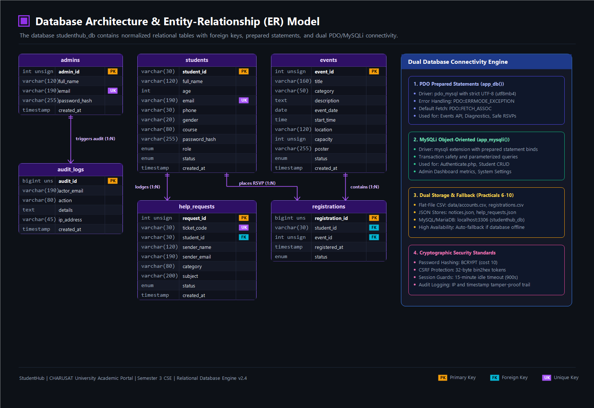

# StudentHub Database Architecture & Setup

This directory contains the database initialization schemas, migration scripts, and diagnostic tools for the **CHARUSAT StudentHub Portal**.

---

## Entity-Relationship (ER) Architecture & Dual Connectivity



The portal utilizes a hybrid dual-persistence model:
1. **Relational Database Engine (MariaDB/MySQL 8.0+)**:
   - Structured relational storage with strict foreign keys (`ON DELETE CASCADE`), unique constraints, and indexes.
   - Dual abstraction layer via `db.php`:
     - **PDO** (`app_db()`): Parameterized queries, exceptions (`ERRMODE_EXCEPTION`), and associative fetching for JSON APIs.
     - **MySQLi** (`app_mysqli()`): Object-oriented prepared statements with type-bound parameters for core transactions.
2. **Dual Flat-File Fallback (Zero-Downtime Resilience)**:
   - Automated offline fallback ensuring the entire portal functions smoothly even without an active MySQL server:
     - `data/accounts.csv` & `data/registrations.csv`: Account & inquiry logging.
     - `data/events.json` & `data/notices.json`: Live circular & event storage.

---

## Database Tables Overview

| Table Name | Description | Key Fields & Constraints |
| :--- | :--- | :--- |
| **`students`** | Enrolled undergraduate records & credentials | `student_id` (PK), `email` (UK), `course`, `password_hash`, `role`, `status` |
| **`admins`** | Institutional administrative officers | `admin_id` (PK), `email` (UK), `password_hash`, `created_at` |
| **`events`** | Technical symposiums, workshops & fests | `event_id` (PK), `title`, `category`, `capacity`, `poster`, `status` |
| **`registrations`** | Student event bookings & passes | `registration_id` (PK), `student_id` (FK), `event_id` (FK), `status` |
| **`audit_logs`** | Security audit trail & access tracking | `audit_id` (PK), `actor_email`, `action`, `details`, `ip_address`, `created_at` |
| **`help_requests`** | Student help desk tickets & inquiries | `request_id` (PK), `ticket_code` (UK), `student_id` (FK), `category`, `status` |

---

## Import Order for Local Setup (XAMPP / MySQL)

1. **Create the Database**:
   ```sql
   CREATE DATABASE studenthub CHARACTER SET utf8mb4 COLLATE utf8mb4_unicode_ci;
   USE studenthub;
   ```

2. **Import Full Production Schema**:
   ```sql
   SOURCE database/schema.sql;
   ```

3. **Import Demo Authentication Accounts**:
   ```sql
   SOURCE practicals/practical10/user_registration.sql;
   ```

4. **Verify Connectivity**:
   - Run the included diagnostic tool:
     ```bash
     php database/test_connection.php
     ```

---

## Demo Credentials

| Role | Username / Identifier | Password | Access Privileges |
| :--- | :--- | :--- | :--- |
| **Student** | `student.demo@example.edu` *(or `25CS045`)* | `Student@12345` | Student Workspace, Timetable, Attendance, Assignments, Help Desk |
| **Administrator** | `admin.demo@example.edu` | `Admin@12345` | Command Center, Student CRUD, Events, Circulars, Inquiry Review, Audit Logs |

