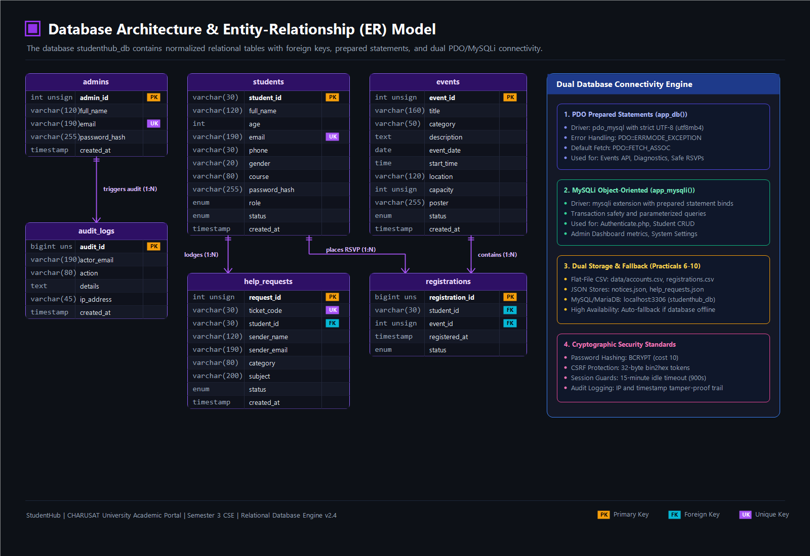

# StudentHub Database Architecture & Schema Reference

- **Database Engine**: MySQL 8.0+ / MariaDB 10.4+ (InnoDB Engine)
- **Default Database Name**: `studenthub`
- **Character Set**: `utf8mb4`
- **Collation**: `utf8mb4_unicode_ci`

---

## 1. Entity Relationship (ER) Summary



The StudentHub schema is structured into 6 normalized tables with foreign keys and strict constraints:
- `students` (role='Student') <--- (1:N) ---> `registrations` <--- (N:1) ---> `events`
- `students` <--- (1:N) ---> `help_requests` (Student Help Desk tickets)
- `admins` (role='Admin') <--- (1:N) ---> `audit_logs`

---

## 2. Table Definitions

### Table: `students`
Stores registered students eligible for portal access and event participation.
- `student_id` (VARCHAR(32), PRIMARY KEY): Unique university roll number (e.g., `25CS045`, `24DCS002`).
- `full_name` (VARCHAR(128), NOT NULL): Full student name.
- `email` (VARCHAR(191), NOT NULL, UNIQUE): Unique email identifier.
- `password_hash` (VARCHAR(255), NOT NULL): BCRYPT / Argon2 secure password hash.
- `role` (ENUM('Student', 'Admin'), DEFAULT 'Student'): RBAC role flag.
- `phone` (VARCHAR(20), NULL): 10-digit mobile number.
- `department` (VARCHAR(64), DEFAULT 'Computer Science & Engineering'): Enrolled department.
- `status` (ENUM('active', 'suspended', 'pending'), DEFAULT 'active'): Account active status.
- `created_at` (DATETIME, DEFAULT CURRENT_TIMESTAMP): Timestamp of creation.

### Table: `admins`
Stores authenticated administrative accounts with system-wide privileges.
- `admin_id` (INT AUTO_INCREMENT, PRIMARY KEY): Unique identifier.
- `full_name` (VARCHAR(128), NOT NULL): Administrator name.
- `email` (VARCHAR(191), NOT NULL, UNIQUE): Institutional login email.
- `password_hash` (VARCHAR(255), NOT NULL): Secure hashed password.
- `role` (ENUM('Admin'), DEFAULT 'Admin'): Administrative role.
- `status` (ENUM('active', 'inactive'), DEFAULT 'active'): Operational status.
- `created_at` (DATETIME, DEFAULT CURRENT_TIMESTAMP).

### Table: `events`
Campus hackathons, workshops, technical competitions, and seminars.
- `event_id` (INT AUTO_INCREMENT, PRIMARY KEY): Unique event identifier.
- `title` (VARCHAR(191), NOT NULL): Program title.
- `category` (VARCHAR(64), NOT NULL): Category (`Hackathon`, `Workshop`, `Webinar`, `Seminar`).
- `description` (TEXT): Comprehensive event details and schedule.
- `location` (VARCHAR(128)): Venue (e.g., `Auditorium 2`, `Lab 632`).
- `event_date` (DATETIME, NOT NULL): Scheduled program date.
- `capacity` (INT, DEFAULT 100): Maximum student attendance cap.
- `poster_path` (VARCHAR(255), NULL): Uploaded promotional poster file.
- `status` (ENUM('open', 'closed', 'cancelled'), DEFAULT 'open').
- `created_at` (DATETIME, DEFAULT CURRENT_TIMESTAMP).

### Table: `registrations`
Tracks student RSVP registrations for campus events.
- `registration_id` (INT AUTO_INCREMENT, PRIMARY KEY).
- `student_id` (VARCHAR(32), NOT NULL, FK -> `students.student_id`).
- `event_id` (INT, NOT NULL, FK -> `events.event_id`).
- `registered_at` (DATETIME, DEFAULT CURRENT_TIMESTAMP).
- `status` (ENUM('registered', 'attended', 'cancelled'), DEFAULT 'registered').
- UNIQUE KEY (`student_id`, `event_id`): Prevents duplicate event RSVPs.

### Table: `audit_logs`
Automated security audit trail logging all administrative and security actions.
- `audit_id` (INT AUTO_INCREMENT, PRIMARY KEY).
- `actor_email` (VARCHAR(191), NOT NULL): User or administrator performing the action.
- `action` (VARCHAR(64), NOT NULL): Action identifier (`LOGIN_SUCCESS`, `STUDENT_CREATE`, `NOTICE_PUBLISH`).
- `details` (TEXT): Audit metadata, changed fields, IP address.
- `created_at` (DATETIME, DEFAULT CURRENT_TIMESTAMP).

---

## 3. Database Initialization Steps

1. In XAMPP MySQL, open phpMyAdmin (`http://localhost/phpmyadmin/`) or MySQL CLI.
2. Create database:
   ```sql
   CREATE DATABASE studenthub CHARACTER SET utf8mb4 COLLATE utf8mb4_unicode_ci;
   USE studenthub;
   ```
3. Import the main schema:
   ```sql
   SOURCE database/studenthub.sql;
   ```
4. Import demo accounts:
   ```sql
   SOURCE practicals/practical10/user_registration.sql;
   ```

