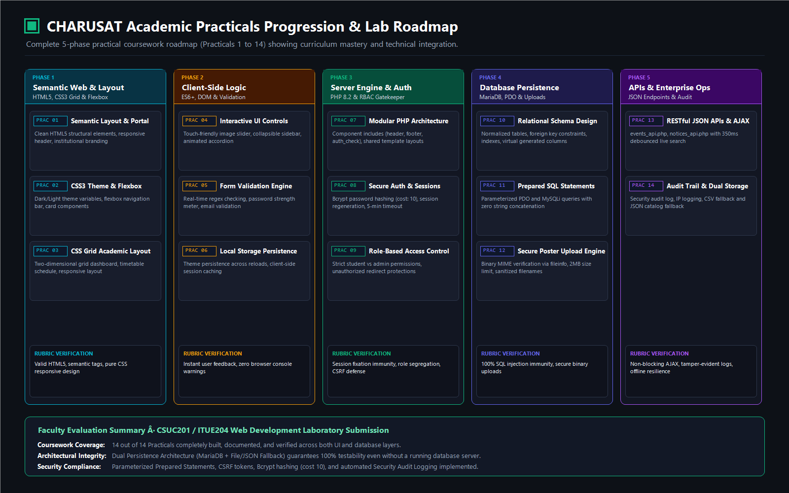

# CHARUSAT Academic Practicals Inventory & Laboratory Map

> **Course**: CSUC201 / ITUE204 — Web Development Frameworks & Technologies  
> **Institution**: Charotar University of Science and Technology (CHARUSAT)  
> **Faculty**: Chandubhai S. Patel Institute of Technology (CSPIT) · Department of Computer Science & Engineering (CSE)  
> **Curriculum Phase**: Semester 3 (Odd Term) · B.Tech CSE Division-I

---

## 5-Phase Curriculum Roadmap & Progression

---

## Comprehensive Practicals Implementation Matrix

| Phase | Practical | Curriculum Objective | Primary Source Files | Lab Artifact Location |
| :--- | :--- | :--- | :--- | :--- |
| **Phase 1: Semantic Web & Layouts** | **Practical 1** | Institutional Portal Architecture & Semantic HTML5 Layout | `index.php`, `pages/about.php`, `includes/layout_head.php` | `practicals/archive/previous-version/` |
| | **Practical 2** | CSS3 Theming, Flexbox Navigation & Responsive Navbar | `css/tokens.css`, `css/app.css`, `css/auth.css` | `practicals/archive/previous-version/` |
| | **Practical 3** | Two-Dimensional CSS Grid Academic Dashboard & Timetable | `student/student_dashboard.php`, `student/student_schedule.php` | `practicals/archive/previous-version/` |
| **Phase 2: Client-Side Dynamics** | **Practical 4** | Interactive Image Carousel, Collapsible Sidebar & Accordion | `js/app.js`, `pages/faq.php`, `includes/student_sidebar.php` | `practicals/archive/previous-version/` |
| | **Practical 5** | Form Validation Engine (Regex, Real-time Checks & Strength) | `register.php`, `login.php`, `student/student_help.php` | `practicals/archive/previous-version/` |
| | **Practical 6** | Local Storage State Management & Dynamic DOM Operations | `js/studyhub.js`, `student/student_assignments.php` | `practicals/archive/previous-version/` |
| **Phase 3: Server Engine & Auth** | **Practical 7** | Modular PHP Architecture, Includes & CSV Persistence | `includes/auth.php`, `includes/helpers.php`, `data/accounts.csv` | `practicals/practical7/` |
| | **Practical 8** | Session Management, Fixation Immunity & Idle Timeout | `authenticate.php`, `logout.php`, `pages/timeout.php` | `practicals/practical10/` |
| | **Practical 9** | Server-Side Validation, Password Hashing (`BCRYPT`) & Dual Storage | `register.php`, `migrations/001_add_student_password_hash.sql` | `practicals/practical9/` |
| **Phase 4: Database Persistence** | **Practical 10** | Relational Database Modeling, Session Gate & Demo Seeding | `database/schema.sql`, `practicals/practical10/user_registration.sql` | `practicals/practical10/` |
| | **Practical 11** | Student Management Module (Prepared Statements CRUD & CSV Export) | `admin/student_management.php`, `data/student_records.csv` | `practicals/practical11/` |
| | **Practical 12** | Event Manager with Poster Uploads (MIME & 2MB File Validation) | `admin/admin_events.php`, `uploads/event-posters/` | `practicals/practical12/` |
| **Phase 5: Modern APIs & Audit** | **Practical 13** | RESTful JSON APIs, AJAX Polling & Non-blocking Feed | `api/events_api.php`, `api/notices_api.php`, `js/studyhub.js` | `practicals/practical13/` |
| | **Practical 14** | Role-Based Access Control (RBAC), Admin Dashboard & Audit Trail | `admin/admin_dashboard.php`, `admin/admin_audit.php`, `includes/audit.php` | `practicals/practical14/` |

---

## Directory Organization & Lab Submissions

- **`practical7/`**: PHP form handler with flat-file CSV dual storage.
- **`practical9/`**: Validated student registration, password hashing verification, and SQL scripts.
- **`practical10/`**: Session gatekeeper, role router, arithmetic security challenge, and demo seeding.
- **`practical11/`**: Administration CRUD module for student records with CSV export.
- **`practical12/`**: Campus event publisher with secure binary file upload validation (fileinfo MIME).
- **`practical13/`**: Asynchronous Fetch API event client and JSON endpoint.
- **`practical14/`**: Executive command dashboard, role-segregated navigation rails, and security audit log.
- **`archive/previous-version/`**: Inactive prototype files and earlier HTML templates safely archived for reference.
